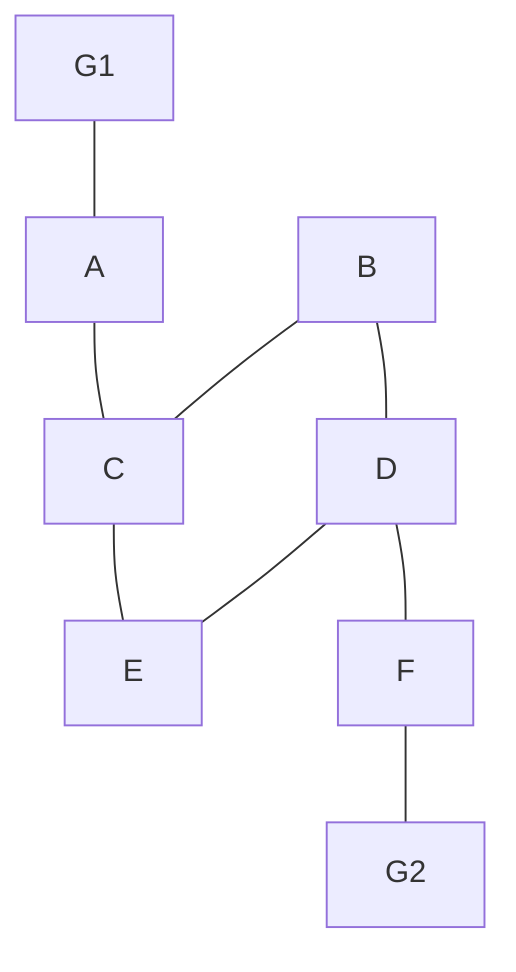

# FireRoute — Hệ thống dẫn đường thoát hiểm khi cháy

FireRoute là prototype IoT một tầng gồm 6 khu vực cảm biến (`A–F`) và 2 cửa thoát (`G1`, `G2`). ESP32 đọc nhiệt độ/khói, phát hiện khu vực nguy hiểm, tính đường thoát bằng Dijkstra và điều khiển LED chỉ hướng. Firebase và dashboard dùng để giám sát; mất Internet không làm dừng việc tính đường hoặc LED.

> Đây là mô hình phục vụ học tập và trình diễn, không phải thiết bị phòng cháy chữa cháy đã được kiểm định.

## 1. Nguyên lý hoạt động

1. ESP32 đọc 6 MQ-2 mỗi 1 giây và 6 DHT11 mỗi 2 giây.
2. Khi nhiệt độ hoặc khói vượt ngưỡng đủ số mẫu liên tiếp, zone được đánh dấu cháy.
3. ESP32 tính route riêng cho **tất cả A–F**, không có một điểm xuất phát chung.
4. Zone cháy không được dùng làm đường trung gian. Người trong chính zone cháy vẫn được chỉ dẫn đi ra.
5. LED xanh sáng ở hướng nên đi, tắt ở hướng không được đi.
6. Trạng thái được gửi lên Firebase khoảng 15 giây/lần và gửi ngay khi có thay đổi.
7. Dashboard hiển thị đồng thời `next-hop` của cả 6 zone. Click một zone chỉ để xem chi tiết toàn tuyến.

## 2. Topology hiện tại

Mô hình một tầng theo `docs/so_do_demo.jpg`:

```text
              G1
        ┌───────────┐
        │     A     │
        ├──────┬────┤
        │  B   │ C  │
        ├──────┼────┤
        │  D   │ E  │
        ├──────┴────┤
        │     F     │
        └───────────┘
              G2
```



Sáu cửa vàng nối `A-C`, `B-C`, `B-D`, `C-E`, `D-E`, `D-F`. `G1` chỉ nối với `A`, `G2` chỉ nối với `F`, nên không còn cạnh vòng dự phòng. Khi `A` cháy, các zone còn lại phải đi qua `F` để ra `G2`; nếu cả `A` và `F` cùng cháy thì các zone giữa không còn tuyến.

Nếu thay đổi mô hình vật lý, phải sửa topology tại các nơi:

- `EDGES`, `LED_COUNT` trong `src/main.cpp`.
- `EDGES`, `POS`, `ROOMS`, `DOORS` và `LED_DIRECTIONS` trong `app.js`.
- Bảng LED, số LED trong `docs/WIRING.md`, `docs/BOM.md` và hai file SVG đấu dây.

## 3. Cấu trúc dự án

```text
HeThongIoT/
├── index.html                 Dashboard
├── styles.css                 Giao diện và animation
├── app.js                     Hiển thị map, Dijkstra và nhận dữ liệu realtime
├── serial_server.py           Cầu nối USB Serial sang dashboard realtime
├── firebase-config.js         Cấu hình Firebase cho web
├── firebase.rules.json        Rules mở dành riêng cho demo
├── mock-data.json             Dữ liệu Firebase mẫu
├── platformio.ini             Cấu hình PlatformIO
├── include/
│   ├── secrets.h              Wi-Fi/Firebase thật, không commit
│   └── secrets.example.h      File cấu hình mẫu
├── src/main.cpp               Firmware ESP32
└── docs/
    ├── ARCHITECTURE.md        Kiến trúc chi tiết
    ├── BOM.md                 Danh sách linh kiện
    └── WIRING.md              Bảng đấu dây và thứ tự LED
```

## 4. Chạy dashboard

Yêu cầu: Python 3 và một trình duyệt hiện đại. Dashboard chỉ nhận dữ liệu thật từ ESP32 qua USB Serial.

Sau khi ESP32 xuất hiện ở `/dev/ttyUSB0`, chạy cầu nối Serial:

```bash
cd /home/sealorl/HeThongIoT
python3 serial_server.py --port 8686 --serial /dev/ttyUSB0
```

Mở `http://localhost:8686`. Dashboard tự cập nhật nhiệt độ, độ ẩm, ADC khói và trạng thái cháy của Zone A–F. Zone chưa đọc được cảm biến sẽ hiện `CHỜ DỮ LIỆU`. Nhấn `Ctrl+C` trong terminal để dừng server.

Nếu báo `Permission denied`, cấp quyền cổng serial một lần rồi khởi động lại WSL:

```bash
sudo usermod -aG dialout $USER
```

Không mở PlatformIO Serial Monitor cùng lúc vì mỗi cổng USB chỉ có thể được một chương trình sử dụng.

Trên bản đồ, mọi zone đều có mũi tên chỉ hướng cùng lúc. Click một zone chỉ làm nổi bật đường đầy đủ của zone đó; các hướng dẫn khác không bị thay đổi.

## 5. Biên dịch và nạp ESP32

Nếu máy chưa có PlatformIO:

```bash
python3 -m pip install --user platformio
```

Kiểm tra firmware trước khi cắm board:

```bash
cd /home/sealorl/HeThongIoT
python3 -m platformio run
```

Khi xuất hiện `[SUCCESS]`, kết nối ESP32 bằng cáp USB có truyền dữ liệu rồi chạy:

```bash
python3 -m platformio run --target upload
python3 -m platformio device monitor
```

Thoát Serial Monitor bằng `Ctrl+C`.

Nếu PlatformIO chọn sai cổng, xem danh sách:

```bash
python3 -m platformio device list
```

Sau đó có thể thêm cổng vào `platformio.ini`:

```ini
upload_port = /dev/ttyUSB0
monitor_port = /dev/ttyUSB0
```

## 6. Test firmware không cần tạo khói thật

Mở Serial Monitor ở baud `115200` rồi nhập:

```text
FIRE B
```

Mô phỏng cháy tại B. Có thể nhập tiếp `FIRE D` để mô phỏng nhiều điểm cháy.

```text
CLEAR
```

Xóa toàn bộ cảnh báo mô phỏng.

```text
AUTO
```

Quay lại sử dụng cảm biến thật.

## 7. Cấu hình Firebase Realtime Database

### 7.1. Tạo database

1. Tạo Firebase project và đăng ký một Web App.
2. Bật Realtime Database, ưu tiên region gần Việt Nam.
3. Trong tab Rules, dùng nội dung `firebase.rules.json` khi trình diễn.

Rules hiện tại cho phép đọc/ghi công khai. Chỉ dùng cho prototype trong thời gian demo; không public database lâu dài với rules này.

### 7.2. Kết nối dashboard

Mở `firebase-config.js` và thay `null` bằng Firebase Web Config:

```js
window.FIREBASE_CONFIG = {
  apiKey: "...",
  authDomain: "<project-id>.firebaseapp.com",
  databaseURL: "https://<database-name>.asia-southeast1.firebasedatabase.app",
  projectId: "<project-id>",
  storageBucket: "<project-id>.appspot.com",
  messagingSenderId: "...",
  appId: "..."
};
```

Không thêm dấu `/` cuối `databaseURL`. Có thể import `mock-data.json` từ giao diện Realtime Database để kiểm tra trước khi kết nối ESP32.

### 7.3. Kết nối ESP32

Mở `include/secrets.h` và điền:

```cpp
#pragma once

#define WIFI_SSID "TEN_WIFI"
#define WIFI_PASSWORD "MAT_KHAU_WIFI"
#define FIREBASE_DATABASE_URL "https://<database-name>.asia-southeast1.firebasedatabase.app"
#define FIREBASE_AUTH ""
```

Với rules demo công khai, để `FIREBASE_AUTH` rỗng. Sau đó build và upload firmware lại. Không commit `include/secrets.h`; file này đã nằm trong `.gitignore`.

## 8. Schema Firebase

```json
{
  "current": {
    "system": {
      "status": "SAFE",
      "lastUpdated": 1788963000000
    },
    "zones": {
      "A": {
        "temperature": 30.2,
        "smoke": 120,
        "fire": false
      }
    },
    "routes": {
      "A": {
        "status": "AVAILABLE",
        "exit": "G1",
        "cost": 1,
        "nodes": ["A", "G1"]
      }
    }
  },
  "fireHistory": {
    "-caseId": {
      "zone": "B",
      "time_start": 1788963000000,
      "time_end": null
    }
  }
}
```

Giá trị `routes.<zone>.status`:

- `AVAILABLE`: zone an toàn và có đường thoát.
- `FIRE`: zone đang cháy nhưng `nodes` vẫn chứa đường để người bên trong rời đi.
- `NO_PATH`: không còn tuyến tới G1 hoặc G2.

## 9. Đấu dây phần cứng

Sơ đồ hình và bảng chân đầy đủ nằm ở `docs/WIRING.md` (`docs/wiring-overview.svg`, `docs/wiring-detail.svg`). Tóm tắt chân ESP32:

| Chức năng | Chân ESP32 |
|---|---|
| DHT11 A–F | GPIO13, 14, 25, 26, 27, 32 |
| Mux #1 (MQ-2) S0–S3 | GPIO16, 17, 18, 19 |
| Mux #1 SIG | GPIO34 |
| Mux #2 và #3 (LED) S0–S3, nối chung | GPIO21, 22, 23, 33 |
| Mux #2 SIG (LED 1–9) | GPIO4 |
| Mux #3 SIG (LED 10–14) | GPIO5 |

Các lưu ý bắt buộc:

- Nối chung GND của ESP32, sạc dự phòng, MQ-2, 3 mux và cathode của LED.
- Không đưa trực tiếp analog 5 V từ MQ-2 vào mux/ESP32. Mỗi AO cần cầu chia áp 10 kΩ + 10 kΩ.
- 5 V từ sạc dự phòng chỉ cấp cho MQ-2. Không nối 5 V vào VIN của ESP32 khi đang cắm USB.
- LED chỉ hướng là 14 LED xanh lá thường (2 LED mỗi cửa, riêng cửa thoát chỉ 1 LED phía trong), quét bằng Mux #2 và #3. Thử 1 LED trước khi đấu hết.
- Firmware `src/main.cpp` đã viết cho cách đấu này (quét LED bằng mux, build thành công); chưa nạp thử trên mạch thật.

## 10. Ngưỡng phát hiện mặc định

| Điều kiện | Giá trị |
|---|---:|
| Báo cháy theo nhiệt độ | ≥ 55 °C |
| Trở lại an toàn theo nhiệt độ | < 48 °C |
| Báo cháy theo MQ-2 | ADC ≥ 2500 |
| Trở lại an toàn theo MQ-2 | ADC < 2200 |
| Xác nhận báo cháy | 3 mẫu liên tiếp |
| Xác nhận hết cháy | 5 mẫu liên tiếp |

Các ngưỡng MQ-2 chỉ là giá trị khởi đầu. Cần làm nóng cảm biến, đo ADC nền của từng module rồi hiệu chuẩn trước khi trình diễn.

## 11. Xử lý lỗi thường gặp

### Dashboard không mở

- Kiểm tra terminal còn chạy `python3 serial_server.py`.
- Mở đúng `http://localhost:8686`, không mở trực tiếp file HTML.
- Nếu cổng bận, chọn cổng khác, ví dụ `python3 serial_server.py --port 8687 --serial /dev/ttyUSB0`.

### Dashboard báo "Không thấy Serial Bridge" hoặc "CHỜ DỮ LIỆU"

- Kiểm tra `serial_server.py` đang chạy và đúng cổng `--serial`.
- Kiểm tra ESP32 đã cắm USB và không có chương trình khác chiếm cổng.
- Mở Developer Tools của trình duyệt để xem lỗi trong Console.

### ESP32 không lên Firebase

- Kiểm tra Wi-Fi 2.4 GHz; ESP32 thường không kết nối mạng 5 GHz-only.
- Kiểm tra `FIREBASE_DATABASE_URL` không có dấu `/` cuối.
- Mở Serial Monitor để xem mã HTTP của `PUT /current`.
- Mã `200` là thành công; `401/403` thường là lỗi quyền truy cập.

### Không upload được ESP32

- Thử cáp USB khác có hỗ trợ dữ liệu.
- Giữ nút `BOOT` khi PlatformIO bắt đầu kết nối.
- Kiểm tra quyền truy cập `/dev/ttyUSB0` hoặc `/dev/ttyACM0`.

### MQ-2 luôn báo cháy

- Kiểm tra cầu chia áp và GND chung.
- Chờ cảm biến làm nóng.
- Ghi lại ADC trong không khí sạch và tăng `FIRE_SMOKE_ADC` cho phù hợp.

## 12. Checklist trước khi demo

- [ ] Firmware build báo `[SUCCESS]`.
- [ ] Sáu DHT11 đều trả nhiệt độ hợp lệ.
- [ ] Sáu kênh MQ-2 có ADC khác 0 và không vượt 4095.
- [ ] Lệnh `FIRE C` làm B, D, E đổi hướng về G2; A vẫn đi G1.
- [ ] 14 LED sáng đúng chiều theo bảng LED trong `docs/WIRING.md`.
- [ ] ESP32 vẫn đổi LED khi tắt Wi-Fi.
- [ ] Firebase nhận `/current` và `/fireHistory`.
- [ ] Dashboard không báo dữ liệu cũ khi ESP32 đang hoạt động.
- [ ] Nguồn và dây không nóng bất thường.
