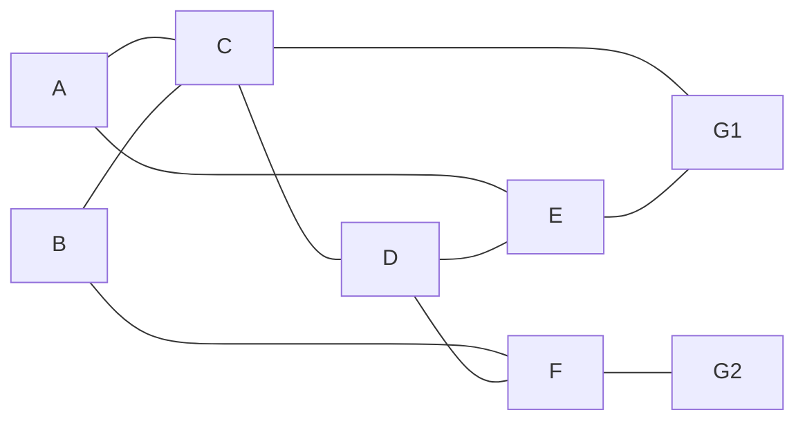

# FireRoute — Hệ thống dẫn đường thoát hiểm khi cháy

FireRoute là prototype IoT một tầng gồm 6 khu vực cảm biến (`A–F`) và 2 cửa thoát (`G1`, `G2`). ESP32 đọc nhiệt độ/khói, phát hiện khu vực nguy hiểm, tính đường thoát bằng Dijkstra và điều khiển LED chỉ hướng. Firebase và dashboard dùng để giám sát; mất Internet không làm dừng việc tính đường hoặc LED.

> Đây là mô hình phục vụ học tập và trình diễn, không phải thiết bị phòng cháy chữa cháy đã được kiểm định.

## 1. Nguyên lý hoạt động

1. ESP32 đọc 6 DHT11 và 6 MQ-2 mỗi 2 giây.
2. Khi nhiệt độ hoặc khói vượt ngưỡng đủ số mẫu liên tiếp, zone được đánh dấu cháy.
3. ESP32 tính route riêng cho **tất cả A–F**, không có một điểm xuất phát chung.
4. Zone cháy không được dùng làm đường trung gian. Người trong chính zone cháy vẫn được chỉ dẫn đi ra.
5. LED xanh chỉ hướng nên đi, LED đỏ chỉ hướng không được đi.
6. Trạng thái được gửi lên Firebase khoảng 15 giây/lần và gửi ngay khi có thay đổi.
7. Dashboard hiển thị đồng thời `next-hop` của cả 6 zone. Click một zone chỉ để xem chi tiết toàn tuyến.

## 2. Topology hiện tại



Các cạnh `A-E`, `B-F` và `E-G1` tạo đường dự phòng. Ví dụ khi C cháy, A chuyển sang `A → E → G1` và B chuyển sang `B → F → G2`.

Nếu thay đổi mô hình vật lý, phải sửa topology tại cả hai nơi:

- `EDGES` trong `src/main.cpp`.
- `EDGES`, `POS` và `ROOMS` trong `app.js`.

## 3. Cấu trúc dự án

```text
HeThongIoT/
├── index.html                 Dashboard
├── styles.css                 Giao diện và animation
├── app.js                     Hiển thị map, Dijkstra và demo mode
├── firebase-config.js         Cấu hình Firebase cho web
├── firebase.rules.json        Rules mở dành riêng cho demo
├── mock-data.json             Dữ liệu Firebase mẫu
├── platformio.ini             Cấu hình PlatformIO
├── include/
│   ├── secrets.h              Wi-Fi/Firebase thật, không commit
│   └── secrets.example.h      File cấu hình mẫu
├── src/main.cpp               Firmware ESP32
└── docs/
    ├── ARCHITECTURE.md        Kiến trúc chi tiết
    ├── BOM.md                 Danh sách linh kiện
    └── WIRING.md              Bảng đấu dây và thứ tự LED
```

## 4. Chạy nhanh dashboard

Yêu cầu: Python 3 và một trình duyệt hiện đại.

```bash
cd /home/sealorl/HeThongIoT
python3 -m http.server 8686
```

Mở `http://localhost:8686`. Nhấn `Ctrl+C` trong terminal để dừng web server.

Khi `window.FIREBASE_CONFIG = null`, dashboard tự chạy ở **Demo Mode**, không cần ESP32 hoặc Internet.

### Thử các tình huống cháy

Trong phần “Bảng điều khiển demo”:

- Bấm `Zone A–F` để bật/tắt cháy từng khu vực.
- `KB1` mô phỏng cháy tại B.
- `KB2` mô phỏng cháy tại hành lang C và kiểm tra đổi tuyến.
- `KB3` mô phỏng nhiều điểm cháy.
- `Khôi phục an toàn` xóa toàn bộ cảnh báo.
- `Phát demo tự động` chạy chuỗi trình diễn.

Trên bản đồ, mọi zone đều có mũi tên chỉ hướng cùng lúc. Click một zone chỉ làm nổi bật đường đầy đủ của zone đó; các hướng dẫn khác không bị thay đổi.

## 5. Biên dịch và nạp ESP32

Nếu máy chưa có PlatformIO:

```bash
python3 -m pip install --user platformio
```

Kiểm tra firmware trước khi cắm board:

```bash
cd /home/sealorl/HeThongIoT
python3 -m platformio run
```

Khi xuất hiện `[SUCCESS]`, kết nối ESP32 bằng cáp USB có truyền dữ liệu rồi chạy:

```bash
python3 -m platformio run --target upload
python3 -m platformio device monitor
```

Thoát Serial Monitor bằng `Ctrl+C`.

Nếu PlatformIO chọn sai cổng, xem danh sách:

```bash
python3 -m platformio device list
```

Sau đó có thể thêm cổng vào `platformio.ini`:

```ini
upload_port = /dev/ttyUSB0
monitor_port = /dev/ttyUSB0
```

## 6. Test firmware không cần tạo khói thật

Mở Serial Monitor ở baud `115200` rồi nhập:

```text
FIRE B
```

Mô phỏng cháy tại B. Có thể nhập tiếp `FIRE D` để mô phỏng nhiều điểm cháy.

```text
CLEAR
```

Xóa toàn bộ cảnh báo mô phỏng.

```text
AUTO
```

Quay lại sử dụng cảm biến thật.

## 7. Cấu hình Firebase Realtime Database

### 7.1. Tạo database

1. Tạo Firebase project và đăng ký một Web App.
2. Bật Realtime Database, ưu tiên region gần Việt Nam.
3. Trong tab Rules, dùng nội dung `firebase.rules.json` khi trình diễn.

Rules hiện tại cho phép đọc/ghi công khai. Chỉ dùng cho prototype trong thời gian demo; không public database lâu dài với rules này.

### 7.2. Kết nối dashboard

Mở `firebase-config.js` và thay `null` bằng Firebase Web Config:

```js
window.FIREBASE_CONFIG = {
  apiKey: "...",
  authDomain: "<project-id>.firebaseapp.com",
  databaseURL: "https://<database-name>.asia-southeast1.firebasedatabase.app",
  projectId: "<project-id>",
  storageBucket: "<project-id>.appspot.com",
  messagingSenderId: "...",
  appId: "..."
};
```

Không thêm dấu `/` cuối `databaseURL`. Có thể import `mock-data.json` từ giao diện Realtime Database để kiểm tra trước khi kết nối ESP32.

### 7.3. Kết nối ESP32

Mở `include/secrets.h` và điền:

```cpp
#pragma once

#define WIFI_SSID "TEN_WIFI"
#define WIFI_PASSWORD "MAT_KHAU_WIFI"
#define FIREBASE_DATABASE_URL "https://<database-name>.asia-southeast1.firebasedatabase.app"
#define FIREBASE_AUTH ""
```

Với rules demo công khai, để `FIREBASE_AUTH` rỗng. Sau đó build và upload firmware lại. Không commit `include/secrets.h`; file này đã nằm trong `.gitignore`.

## 8. Schema Firebase

```json
{
  "current": {
    "system": {
      "status": "SAFE",
      "lastUpdated": 1788963000000
    },
    "zones": {
      "A": {
        "temperature": 30.2,
        "smoke": 120,
        "fire": false
      }
    },
    "routes": {
      "A": {
        "status": "AVAILABLE",
        "exit": "G1",
        "cost": 3,
        "nodes": ["A", "C", "G1"]
      }
    }
  },
  "fireHistory": {
    "-caseId": {
      "zone": "B",
      "time_start": 1788963000000,
      "time_end": null
    }
  }
}
```

Giá trị `routes.<zone>.status`:

- `AVAILABLE`: zone an toàn và có đường thoát.
- `FIRE`: zone đang cháy nhưng `nodes` vẫn chứa đường để người bên trong rời đi.
- `NO_PATH`: không còn tuyến tới G1 hoặc G2.

## 9. Đấu dây phần cứng

Xem bảng đầy đủ tại `docs/WIRING.md`. Tóm tắt chân ESP32:

| Chức năng | Chân ESP32 |
|---|---|
| DHT11 A–F | GPIO13, 14, 25, 26, 27, 32 |
| CD74HC4067 S0–S3 | GPIO16, 17, 18, 19 |
| CD74HC4067 SIG | GPIO34 |
| WS2812B DATA | GPIO23 |

Các lưu ý bắt buộc:

- Nối chung GND của ESP32, nguồn 5 V, MQ-2, multiplexer và LED.
- Không đưa trực tiếp analog 5 V từ MQ-2 vào CD74HC4067/ESP32.
- Dùng cầu chia áp trên từng đầu ra MQ-2 như hướng dẫn trong `docs/WIRING.md`.
- Cấp WS2812B từ nguồn 5 V ngoài, không cấp cả dải LED qua chân nguồn yếu của board.
- Topology hiện tại dùng 20 pixel WS2812B; thứ tự pixel nằm trong `docs/WIRING.md`.

## 10. Ngưỡng phát hiện mặc định

| Điều kiện | Giá trị |
|---|---:|
| Báo cháy theo nhiệt độ | ≥ 55 °C |
| Trở lại an toàn theo nhiệt độ | < 48 °C |
| Báo cháy theo MQ-2 | ADC ≥ 1800 |
| Trở lại an toàn theo MQ-2 | ADC < 1400 |
| Xác nhận báo cháy | 3 mẫu liên tiếp |
| Xác nhận hết cháy | 5 mẫu liên tiếp |

Các ngưỡng MQ-2 chỉ là giá trị khởi đầu. Cần làm nóng cảm biến, đo ADC nền của từng module rồi hiệu chuẩn trước khi trình diễn.

## 11. Xử lý lỗi thường gặp

### Dashboard không mở

- Kiểm tra terminal còn chạy `python3 -m http.server 8686`.
- Mở đúng `http://localhost:8686`, không mở trực tiếp file HTML.
- Nếu cổng bận, chọn cổng khác, ví dụ `python3 -m http.server 8687`.

### Dashboard chỉ hiện Demo Mode

- Kiểm tra `firebase-config.js` không còn là `null`.
- Kiểm tra `databaseURL` và rules Firebase.
- Mở Developer Tools của trình duyệt để xem lỗi trong Console.

### ESP32 không lên Firebase

- Kiểm tra Wi-Fi 2.4 GHz; ESP32 thường không kết nối mạng 5 GHz-only.
- Kiểm tra `FIREBASE_DATABASE_URL` không có dấu `/` cuối.
- Mở Serial Monitor để xem mã HTTP của `PUT /current`.
- Mã `200` là thành công; `401/403` thường là lỗi quyền truy cập.

### Không upload được ESP32

- Thử cáp USB khác có hỗ trợ dữ liệu.
- Giữ nút `BOOT` khi PlatformIO bắt đầu kết nối.
- Kiểm tra quyền truy cập `/dev/ttyUSB0` hoặc `/dev/ttyACM0`.

### MQ-2 luôn báo cháy

- Kiểm tra cầu chia áp và GND chung.
- Chờ cảm biến làm nóng.
- Ghi lại ADC trong không khí sạch và tăng `FIRE_SMOKE_ADC` cho phù hợp.

## 12. Checklist trước khi demo

- [ ] Firmware build báo `[SUCCESS]`.
- [ ] Sáu DHT11 đều trả nhiệt độ hợp lệ.
- [ ] Sáu kênh MQ-2 có ADC khác 0 và không vượt 4095.
- [ ] Lệnh `FIRE C` làm A đổi hướng sang E và B đổi hướng sang F.
- [ ] LED xanh/đỏ đúng chiều theo bảng pixel.
- [ ] ESP32 vẫn đổi LED khi tắt Wi-Fi.
- [ ] Firebase nhận `/current` và `/fireHistory`.
- [ ] Dashboard không báo dữ liệu cũ khi ESP32 đang hoạt động.
- [ ] Nguồn và dây không nóng bất thường.

