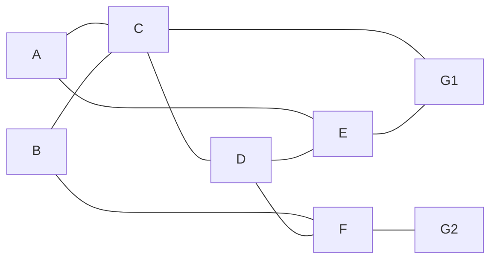

# Thiết kế hệ thống FireRoute

## Topology prototype



Các cạnh có trọng số: `A-C=2`, `B-C=2`, `C-D=2`, `D-E=2`, `D-F=2`, `C-G1=1`, `F-G2=1`, `A-E=3`, `B-F=3`, `E-G1=1`. Ba cạnh bổ sung tạo đường vòng khi một hành lang bị cháy chặn.

## Luồng xử lý

1. ESP32 đọc sáu DHT11 và lần lượt chọn sáu MQ-2 qua CD74HC4067 mỗi 2 giây.
2. Một zone chuyển sang cháy sau ba mẫu nguy hiểm liên tiếp. Nó chỉ trở lại an toàn sau năm mẫu dưới ngưỡng an toàn liên tiếp.
3. ESP32 chạy Dijkstra riêng cho cả sáu điểm A–F. Zone cháy bị cấm làm điểm trung gian, nhưng khi chính nó là điểm bắt đầu, hệ thống vẫn tính hướng đi ra cho người đang ở trong đó.
4. Mỗi pixel LED biểu diễn một chiều qua cửa: xanh nếu chiều đó là next-hop của ít nhất một tuyến an toàn, đỏ nếu không được đi.
5. ESP32 ghi `/current` lên Firebase mỗi 15 giây và ghi ngay khi trạng thái thay đổi. Mỗi lần zone bắt đầu/kết thúc cháy tạo hoặc đóng một mục `/fireHistory`.
6. Mất Wi-Fi không ảnh hưởng việc đọc sensor, tính tuyến hay LED.

## Ngưỡng mặc định

- Báo cháy: nhiệt độ ≥ 55 °C hoặc MQ-2 ADC ≥ 1800.
- Hết báo cháy: nhiệt độ < 48 °C và MQ-2 ADC < 1400.
- Đây là ngưỡng demo, không phải ngưỡng an toàn được chứng nhận. Phải ghi lại ADC nền và ADC khi tạo khói thử để hiệu chuẩn từng MQ-2.

## Chế độ demo qua Serial Monitor

```text
FIRE B   mô phỏng cháy ở B
FIRE D   thêm cháy ở D
CLEAR    xóa toàn bộ cháy mô phỏng
AUTO     quay lại sử dụng cảm biến thật
```
