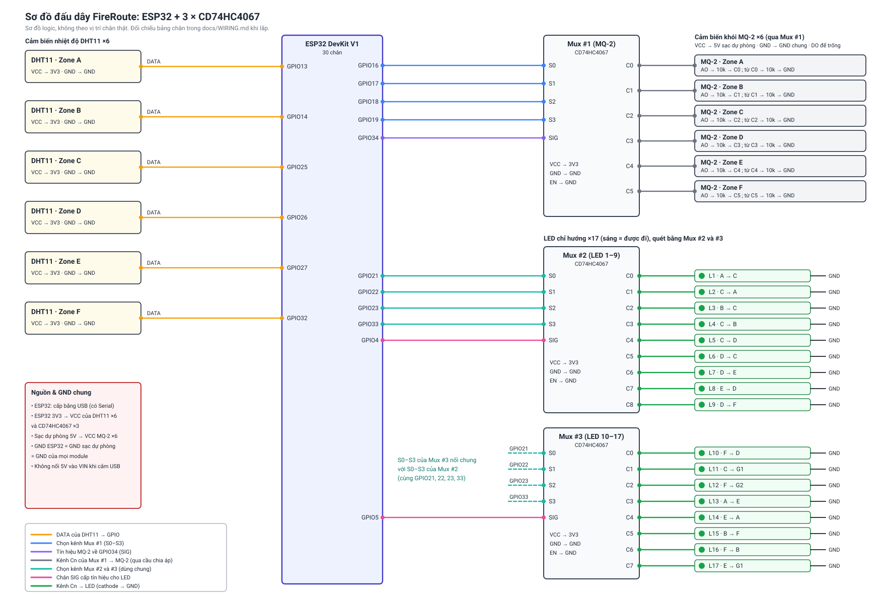
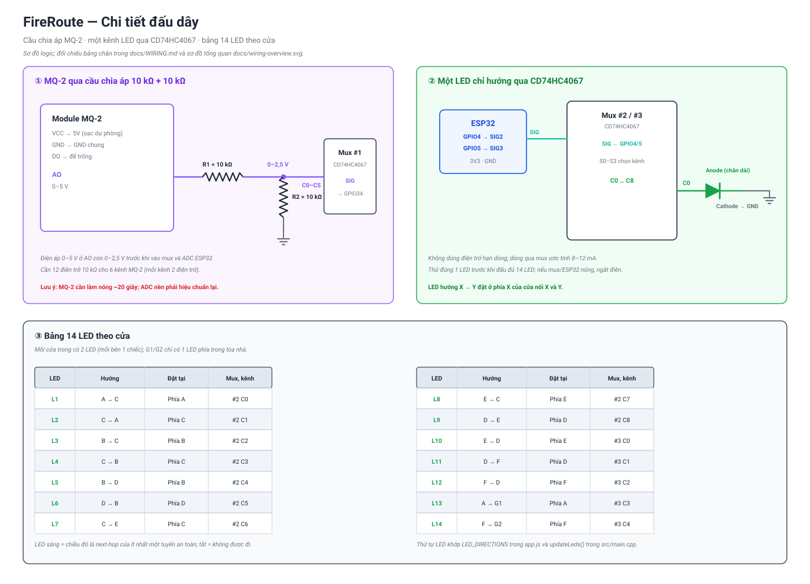

# Sơ đồ đấu dây prototype

Sơ đồ dùng linh kiện thực tế của nhóm: ESP32 DevKit 30 chân, 6 DHT11, 6 MQ-2, 3 CD74HC4067, 14 LED xanh 2 chân, điện trở 10 kΩ và sạc dự phòng 5 V. Ảnh mô hình gốc của nhóm nằm ở `docs/so_do_demo.jpg`.





> Hai sơ đồ là sơ đồ logic, không theo vị trí chân vật lý. Khi lắp, luôn đối chiếu bảng chân bên dưới.

## 1. Tổng hợp chân ESP32

| Chức năng | Chân ESP32 |
|---|---|
| DHT11 A–F (DATA) | GPIO13, 14, 25, 26, 27, 32 |
| Mux #1 S0–S3 (chọn kênh MQ-2) | GPIO16, 17, 18, 19 |
| Mux #1 SIG (đọc MQ-2) | GPIO34 (ADC1, chỉ vào) |
| Mux #2 và #3 S0–S3 (chọn kênh LED, nối chung) | GPIO21, 22, 23, 33 |
| Mux #2 SIG (cấp tín hiệu LED 1–9) | GPIO4 |
| Mux #3 SIG (cấp tín hiệu LED 10–14) | GPIO5 |

Không chân nào bị trùng. Không dùng GPIO0, 2, 12, 15 để tránh lỗi khi nạp/khởi động.

## 2. Nguồn và GND

| Nguồn | Cấp cho |
|---|---|
| USB máy tính → ESP32 | ESP32 và cổng Serial cho dashboard |
| Chân 3V3 của ESP32 | VCC của 6 DHT11 và VCC của 3 mux |
| 5 V từ sạc dự phòng | VCC của 6 MQ-2 |
| GND | Nối chung: ESP32, sạc dự phòng, 6 DHT11, 6 MQ-2, 3 mux, cathode của mọi LED |

Lưu ý:

- Không nối 5 V của sạc dự phòng vào chân VIN/5V của ESP32 khi đang cắm USB máy tính.
- MQ-2 cần làm nóng. Sáu module ăn khoảng 0,9 A; dùng cổng 5 V của sạc dự phòng, không lấy từ USB máy tính.
- Một số sạc dự phòng tự tắt khi dòng quá nhỏ. Nếu nguồn tự ngắt, chọn sạc có chế độ dòng thấp hoặc thêm tải.
- Nếu GND bị bỏ sót, kết quả đọc MQ-2 sẽ nhảy lung tung.

## 3. DHT11

| Zone | DATA |
|---|---:|
| A | GPIO13 |
| B | GPIO14 |
| C | GPIO25 |
| D | GPIO26 |
| E | GPIO27 |
| F | GPIO32 |

- VCC → 3V3; GND → GND.
- Module DHT11 loại 3 chân thường đã có điện trở kéo lên. Nếu dùng cảm biến rời 4 chân thì thêm điện trở 10 kΩ giữa DATA và 3V3.

## 4. MQ-2 qua Mux #1

| CD74HC4067 #1 | Nối tới |
|---|---|
| S0, S1, S2, S3 | GPIO16, 17, 18, 19 |
| SIG | GPIO34 |
| EN | GND |
| VCC | 3V3 |
| GND | GND chung |
| C0 … C5 | Đầu ra AO của MQ-2 Zone A … F, qua cầu chia áp |

**Cầu chia áp cho mỗi MQ-2 (làm 6 lần):**

```text
MQ-2 AO ──[ 10 kΩ ]──┬──→ chân Cn của mux
                     │
                  [ 10 kΩ ]
                     │
                    GND
```

- Điện áp 0–5 V ở AO còn 0–2,5 V, an toàn cho mux (cấp 3,3 V) và ESP32.
- Cần 12 điện trở 10 kΩ cho phần này.
- Chân DO của MQ-2 không dùng, để trống.
- Điện áp chia đôi nên ADC đọc được chỉ bằng khoảng một nửa so với thiết kế cũ. Ngưỡng tạm thời trong firmware là `FIRE_SMOKE_ADC = 2500` và `SAFE_SMOKE_ADC = 2200`; phải hiệu chuẩn lại bằng khói thật.

## 5. LED chỉ hướng (14 LED xanh, quét bằng Mux #2 và #3)

LED thường không dùng chung một dây dữ liệu như WS2812B. Thiết kế này dùng hai mux để chọn từng LED, mỗi mux cấp tín hiệu cho một nhóm.

Mỗi cửa trong có 2 LED, mỗi bên cửa một chiếc. Cửa thoát G1/G2 chỉ có 1 LED phía trong tòa nhà, nên tổng cộng là 14 LED.

| | Mux #2 | Mux #3 |
|---|---|---|
| S0–S3 | GPIO21, 22, 23, 33 | GPIO21, 22, 23, 33 (nối chung với Mux #2) |
| SIG | GPIO4 | GPIO5 |
| EN | GND | GND |
| VCC | 3V3 | 3V3 |
| GND | GND chung | GND chung |
| Số LED | 9 (C0–C8) | 5 (C0–C4) |

**Mỗi LED:** anode (chân dài) → chân Cn của mux; cathode (chân ngắn) → GND chung.
LED hướng `X → Y` đặt ở phía `X` của cửa nối `X` và `Y`.

| LED | Mux, kênh | Hướng | LED | Mux, kênh | Hướng |
|---:|---|---|---:|---|---|
| L1 | #2 C0 | A → C | L8 | #2 C7 | E → C |
| L2 | #2 C1 | C → A | L9 | #2 C8 | D → E |
| L3 | #2 C2 | B → C | L10 | #3 C0 | E → D |
| L4 | #2 C3 | C → B | L11 | #3 C1 | D → F |
| L5 | #2 C4 | B → D | L12 | #3 C2 | F → D |
| L6 | #2 C5 | D → B | L13 | #3 C3 | A → G1 |
| L7 | #2 C6 | C → E | L14 | #3 C4 | F → G2 |

Thứ tự LED khớp `LED_DIRECTIONS` trong `app.js` và `updateLeds()` trong `src/main.cpp`.

**Cách hoạt động và giới hạn:**

- LED sáng nghĩa là chiều đó được đi, tắt nghĩa là không đi. Không còn đỏ/xanh vì nhóm chỉ có LED xanh.
- Mỗi mux chỉ nối một kênh tại một thời điểm. Firmware phải quét tất cả LED rất nhanh (vài trăm Hz) để mắt thấy sáng liên tục. Hai mux chạy song song nên tối đa 2 LED sáng cùng lúc.
- Không có điện trở hạn dòng. Dòng đi qua điện trở trong của GPIO và mux, ước tính khoảng 8–12 mA, nhưng giá trị này chưa đo thực tế. **Thử đúng 1 LED trước khi đấu hết.** Nếu LED quá mờ thì tăng tần số quét; nếu mux hoặc ESP32 nóng bất thường thì ngắt điện ngay.
- Chỉ dùng LED xanh lá. LED xanh dương hoặc trắng có điện áp thuận khoảng 3 V nên gần như không sáng với 3,3 V.
- LED sẽ mờ hơn so với WS2812B vì chỉ sáng một phần thời gian.

> Firmware `src/main.cpp` đã viết theo cách đấu này: task `ledScanTask` chạy ở core 0, quét 9 kênh của hai mux và bật tín hiệu SIG cho LED nào đang được phép đi. Firmware đã build thành công nhưng chưa nạp thử trên mạch thật.
